# Game Programmer Portfolio

## 本村 一矢（モトムラ カズヤ）
Unity / C# Game Programmer

UnityとC#を使用したゲーム制作を中心に、
企画・ゲームロジック・UI制作・オブジェクト制御などを経験しています。

チーム制作では企画やプログラミングを担当し、
個人制作では企画から実装まで一貫して開発しました。

---

## Skills

- Unity
- C#
- 2D / 3Dゲーム制作
- ゲームロジック実装
- UI制作・制御
- アニメーション制御
- 当たり判定
- オブジェクト管理
- ランダム生成
- カメラ制御
- レベルデザイン
- デバッグ

---

## Works

### 1. カクカクビリヤード

- ジャンル：2Dアクション・パズルゲーム
- プラットフォーム：iOS / Android
- 制作期間：4週間
- チーム人数：3人
- 担当：企画・プログラム全般
- 開発環境：Unity / C#

ボールを引っ張って発射し、障害物を避けながら
ゴールを目指すスマートフォン向けゲーム。

**実装・工夫した点**
- ボールの形状変化によるプレイ感の変化
- 6種類のステージとギミック制作
- ゴール時の演出
- 画面サイズに応じたUI・ギミック調整

**習得した技術**
シーン管理 / UI制御 / オブジェクト管理 / レスポンシブ対応

---

### 2. カラーダッシュヒーローズ

- ジャンル：色合わせ・反射アクションゲーム
- プラットフォーム：iOS / Android
- 制作期間：4週間
- チーム人数：3人
- 担当：企画・プログラミング
- 開発環境：Unity / C#

ヒーローの先頭カラーを切り替え、
敵と同じ色を選んで倒していくゲーム。

**実装・工夫した点**
- ヒーローの並び順と表示位置の制御
- 疑似3Dによる奥行き表現
- 敵撃破時の吹き飛び演出
- 約1分で遊べるゲームテンポの調整

**習得した技術**
オブジェクトの順序管理 / 疑似3D演出 / エフェクト制御

---

### 3. タートルディープアドベンチャー

- ジャンル：海中ランアクションゲーム
- プラットフォーム：iOS / Android
- 制作期間：4週間
- チーム人数：3人
- 担当：企画・プログラミング
- 開発環境：Unity / C#

ウミガメを操作し、障害物を避けながら
海中のお宝を集めるゲーム。

**実装・工夫した点**
- 地形パーツのランダム生成
- 地形の接続条件の制御
- 無限スクロール
- カメラ追従処理
- 敵キャラクターの挙動制御

**習得した技術**
ランダム生成 / カメラ制御 / オブジェクト生成・削除

---

### 4. 新大陸での属性学

- ジャンル：推理・クイズゲーム
- プラットフォーム：iOS / Android
- 制作期間：4週間
- チーム人数：3人
- 担当：企画・プログラミング
- 開発環境：Unity / C#

調査メモを参考に、架空の生物や物質の属性を
推理して当てるゲーム。

**実装・工夫した点**
- 150種類以上のお題のデータ管理
- 難易度別の出題制御
- 重複出題の防止
- 情報を段階的に解放する図鑑機能
- レア問題の抽選機能

**習得した技術**
データ設計 / ランダム抽選 / 条件分岐 / 進行状況管理

### ゲーム画面

  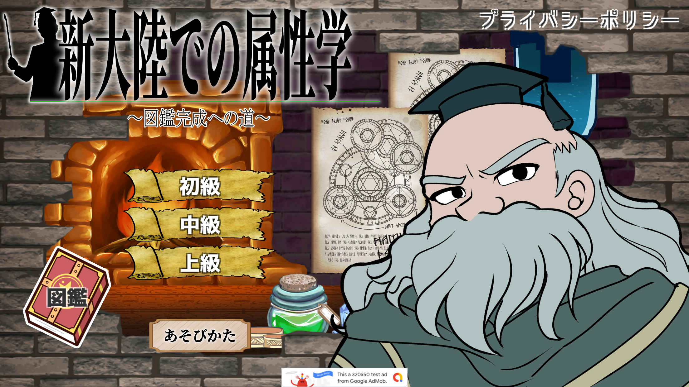
  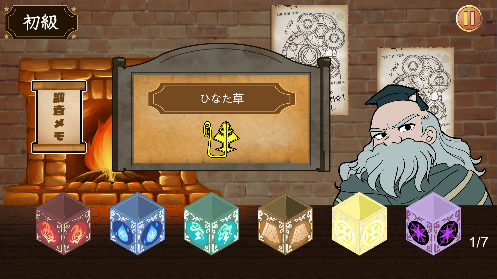
  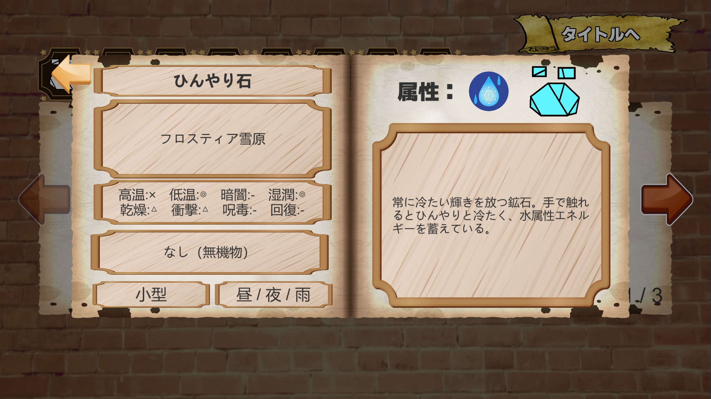

---

### 5. できたて！ポーションスタンド

- ジャンル：レシピ暗記・タイムアタックゲーム
- プラットフォーム：iOS / Android
- 制作期間：4週間
- チーム人数：3人
- 担当：プログラミング
- 開発環境：Unity / C#

ランダム生成されるレシピを参考に、
制限時間内にポーションを作成するゲーム。

**実装・工夫した点**
- レシピのランダム生成
- 注文内容のランダム生成
- 難易度に応じた調合工程の変更
- 調合手順の正誤判定
- ライフ・タイマー管理

**習得した技術**
ランダム生成 / タイマー制御 / ゲーム状態管理 / UI更新

### ゲーム画面

  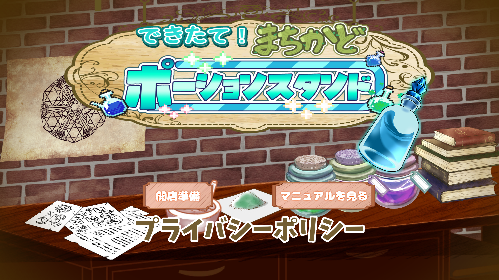
  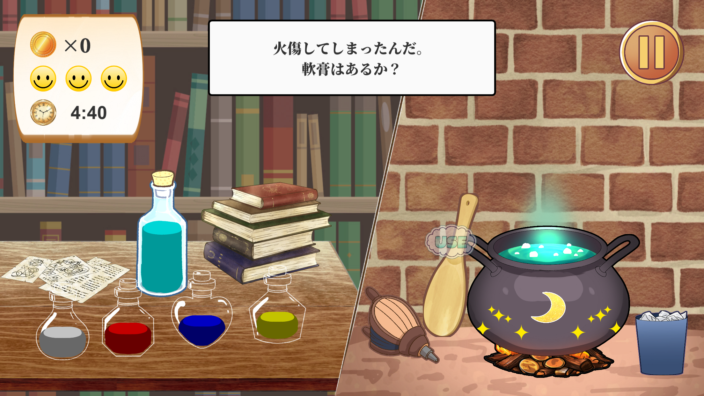
  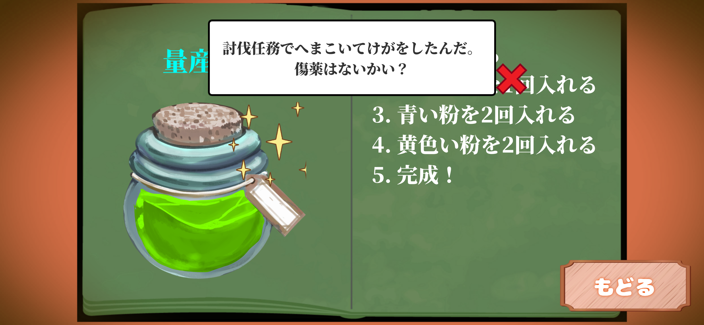

---

### 6. 旗取りダッシュ

- ジャンル：3Dアクション・タイムアタック
- プラットフォーム：Windows / iOS / Android
- 制作期間：6週間
- チーム人数：1人
- 担当：企画・プログラム・各種機能の実装
- 開発環境：Unity / C#

TPS視点でプレイヤーを操作し、
ランダムに配置される旗を獲得するまでのタイムを競うゲーム。

**ランキング機能**
- XAMPPを使用したランキングデータ管理を実装
- プレイ記録から上位10件のスコアを管理
- 英数字3文字の名前登録に対応
- データの保存・読み込み処理を実装
- ローカル環境でのサーバー連携を含むランキングシステムの実装経験

**実装・工夫した点**
- スタート地点とゴール地点のランダム選択
- 距離条件を考慮したゴール配置
- 上位10件のランキング機能
- BGM・SEの個別音量設定
- 日本語・英語の言語切り替え
- 操作キー設定の変更・保存
- プレイヤー操作・カメラ制御
- Windows / スマートフォン対応

**習得した技術**
3Dプレイヤー制御 / カメラ制御 / データ保存 / ランキング管理 / オプション管理 / マルチプラットフォーム対応

### ゲーム画面

### 旗取りダッシュ

  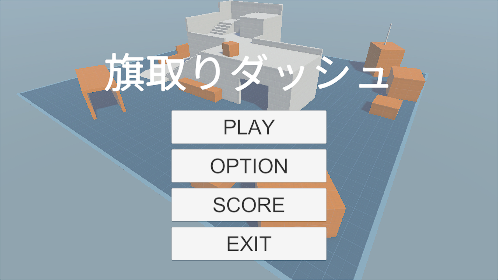
  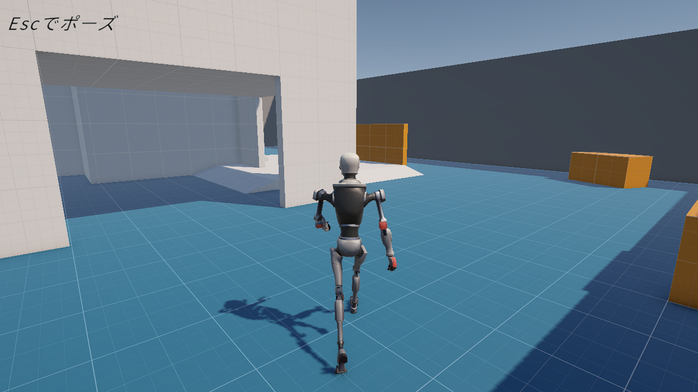
  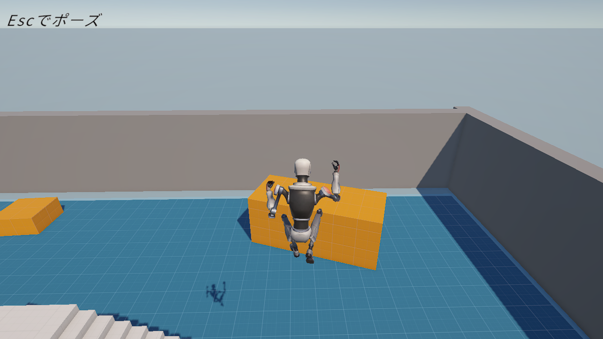

  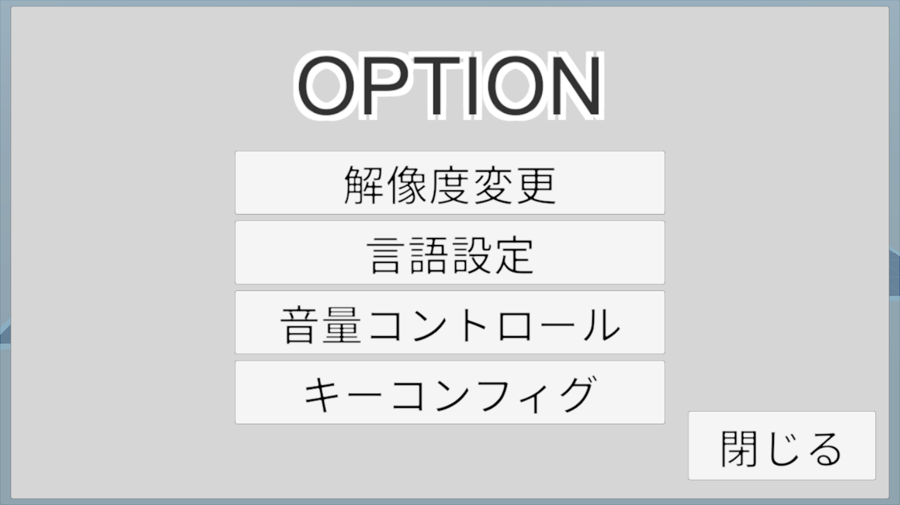
  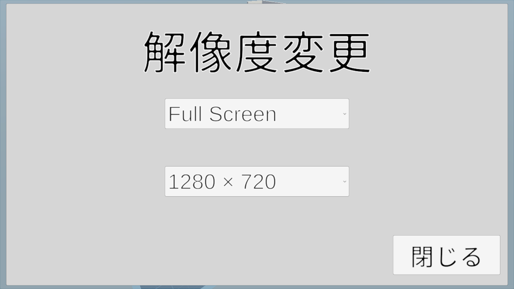
  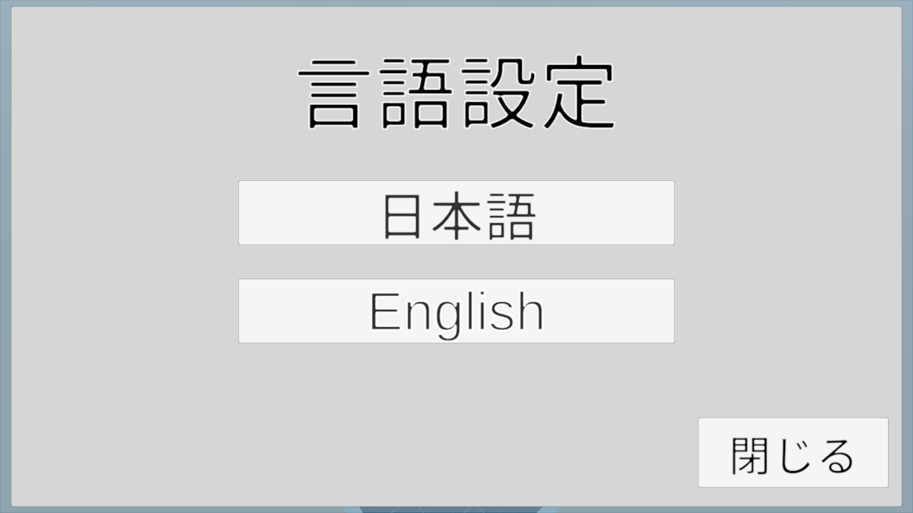

  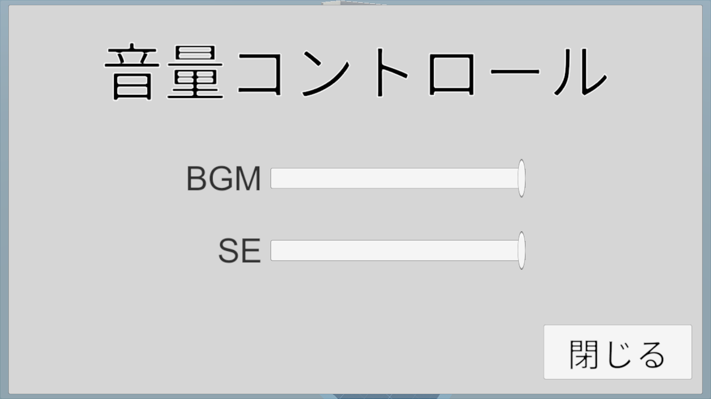
  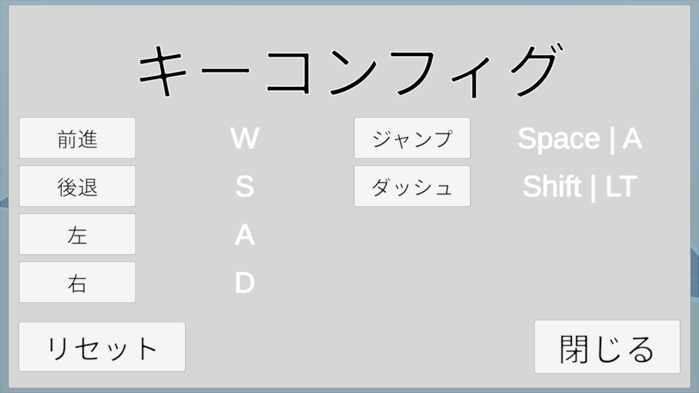
  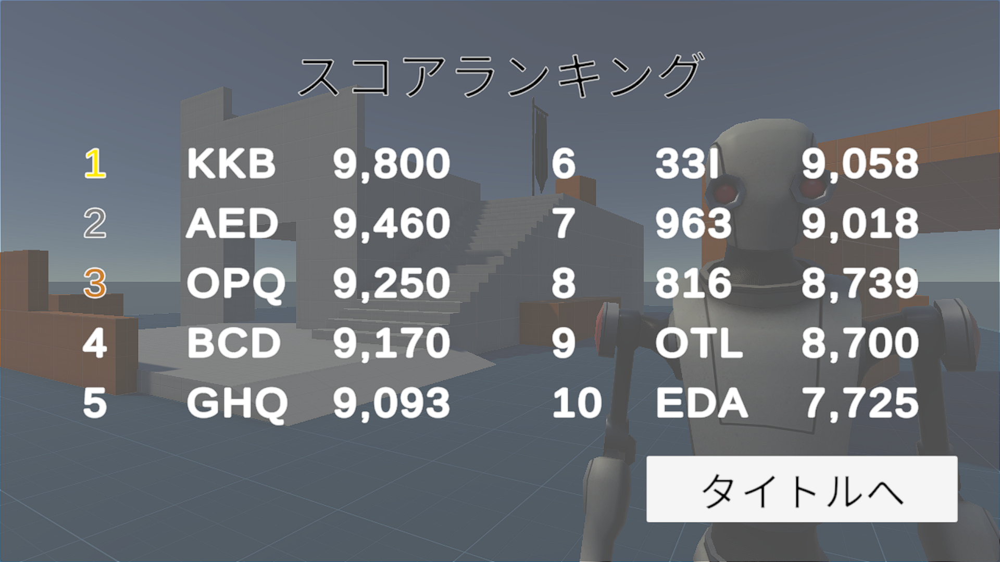

[作品の詳細・ソースコードはこちら](source/FlagDash/README.md)

---

## Other Skills

- 動画編集：AviUtl / ゆっくりムービーメーカー4
- サムネイル制作
- Word
- Excel

個人YouTubeチャンネルの運営経験あり。
動画編集・サムネイル制作も独学で習得。
