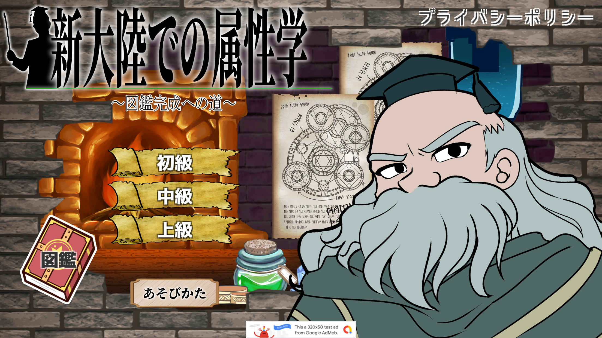
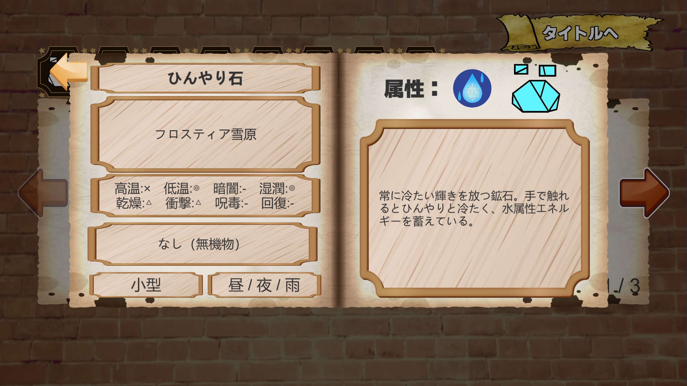
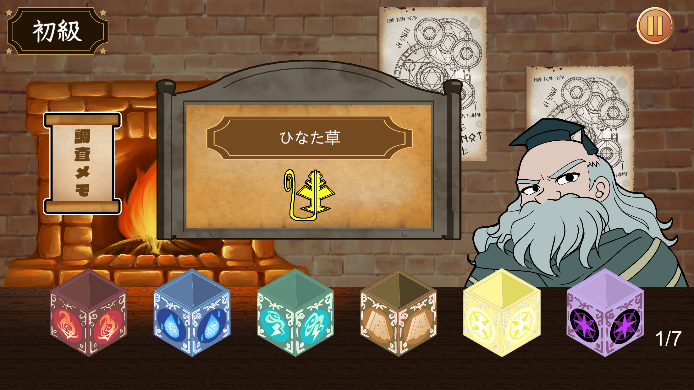

# 新大陸での属性学

## 作品概要

調査メモを参考に、架空の生物や物質が持つ属性を推理して当てるクイズゲームです。

150種類以上のお題を収録し、名前や属性、生息地、特徴などの情報をもとに推理を楽しめます。また、プレイ状況に応じて情報が解放される図鑑機能を搭載し、ゲームの世界観や生物の設定を楽しめる作品にしました。

## 制作情報

| 項目 | 内容 |
|---|---|
| ジャンル | 推理・クイズゲーム |
| プラットフォーム | スマートフォン（iOS / Android） |
| 制作期間 | 4週間 |
| チーム人数 | 3人 |
| 担当 | 企画・C#プログラミング・ゲームシステムの実装 |
| チーム内分担 | イラスト制作、動作確認・Webサイトへの掲載 |
| 使用ソフト | Unity（C#） |

## ゲーム画面

### タイトル画面

### クイズプレイ画面

### 図鑑画面

## 主な実装機能

### クイズシステム
- 難易度に応じた出題対象の切り替え
- 生息地や食性などの情報を利用した問題生成
- 同一プレイ中の問題重複を防止
- 最後の問題で一定確率で出現するレア問題

### 図鑑システム
- 問題への遭遇・正解状況に応じた情報の段階的な解放
- 生物の発見状況や解放状況の保存
- 図鑑の解放率をパーセンテージで表示
- カテゴリー別の一覧表示とページ切り替え

### データ管理
- ScriptableObjectを利用した生物データの管理
- 名前、属性、生息地、特徴、大きさ、食性などの情報を個別に管理

### UI・演出
- 回答時のアニメーション演出
- チュートリアルのページ切り替え
- 難易度選択やリザルト画面の制御

## 工夫した点

- 150種類以上のお題を制作し、それぞれの生物・物質に関する情報を個別に管理できるようにした。
- 難易度ごとに出題対象を分け、同じプレイ中に問題が重複しないよう制御した。
- 問題への遭遇状況や正解状況に応じて、図鑑の情報が段階的に解放される仕組みを実装した。
- 最後の問題では一定確率でレア問題が出現するようにし、通常とは異なる出題を楽しめるようにした。
- 図鑑の解放率をパーセンテージで表示し、収集の進捗を確認できるようにした。

## 苦労した点

- 150種類以上のお題のデータ作成と管理。
- 属性や推理要素の整合性を保ちながら問題を設計すること。
- 問題の出題状況と正解状況に応じた図鑑情報の解放管理。
- 図鑑の表示内容と解放率の整合性を保つ処理。

## 身についた技術

- データ設計・管理
- 条件分岐と出題制御
- ランダム抽選
- 進行状況の管理
- UI制御
- 収集・解放システムの実装

## ソースコード

C#スクリプトは以下のフォルダに掲載しています。

[ソースコード一覧（Scripts）](Scripts/)

主なスクリプト：
- `QuizManager.cs`
- `CreatureData.cs`
- `EncyclopediaManager.cs`
- `EncyclopediaListUI.cs`
- `AnswerEffectPlayer.cs`

