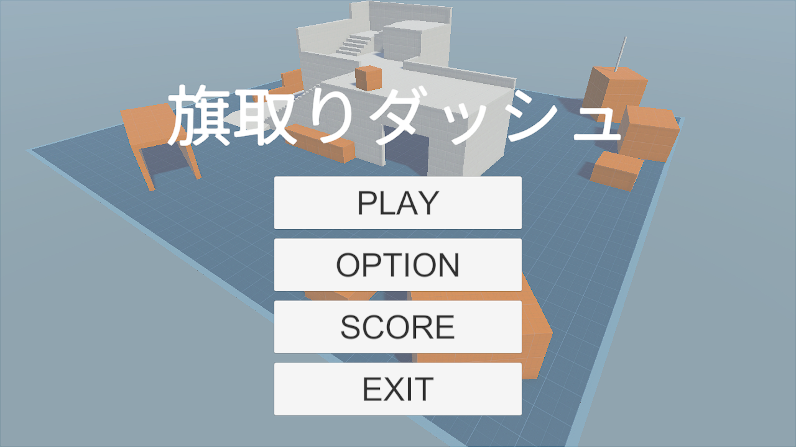
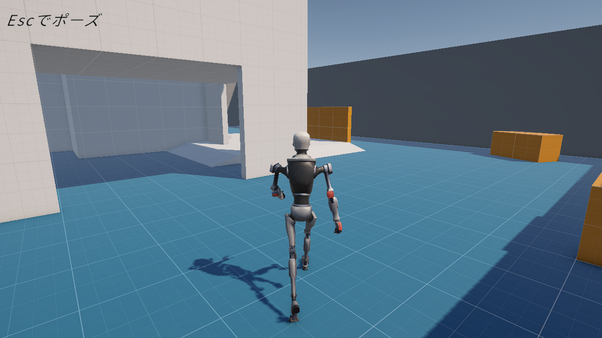
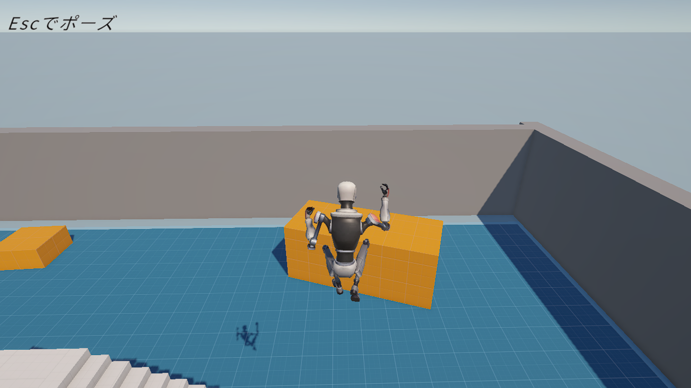
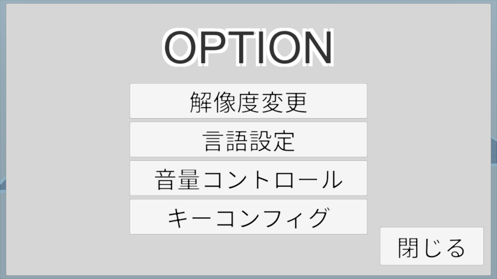
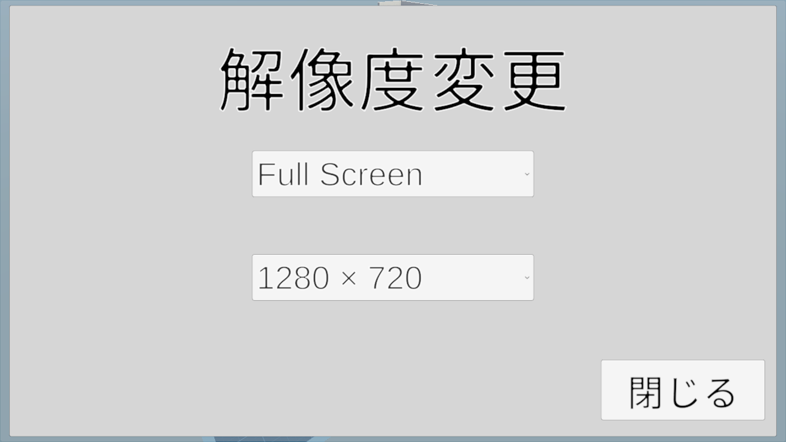
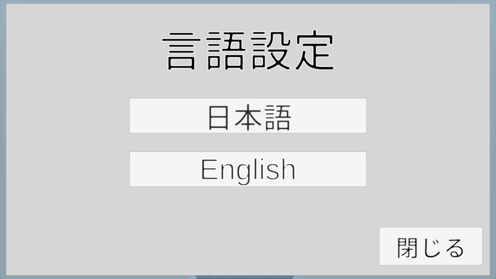
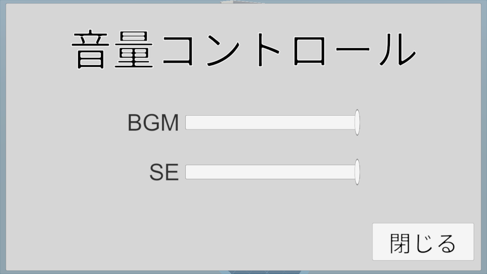
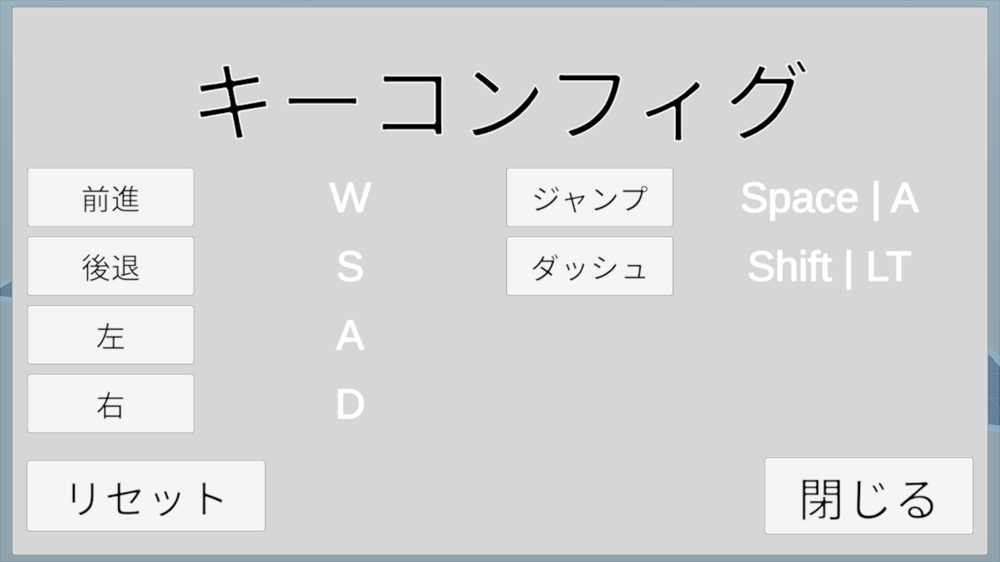
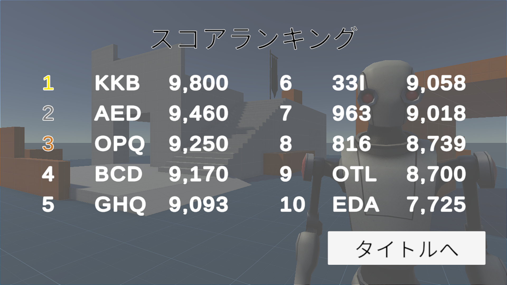

# 旗取りダッシュ

## ゲーム概要

TPS視点でプレイヤーを操作し、フィールド内にランダムで配置される旗を探して獲得する、3Dアクション・タイムアタックゲームです。

スタート地点とゴール地点がプレイごとに変化するため、毎回異なるフィールド状況でゴールを目指します。

本作品は、企画からプログラミング、各種機能の実装まで一人で制作しました。また、Windowsとスマートフォン（iOS / Android）でのプレイを想定して開発しました。

## 作品情報

| 項目 | 内容 |
|---|---|
| ジャンル | 3Dアクションゲーム・タイムアタック |
| 制作期間 | 6週間 |
| 制作人数 | 1人 |
| 開発環境 | Unity |
| 使用言語 | C# |
| 対応プラットフォーム | Windows / iOS / Android |
| 担当範囲 | 企画・プログラム・各種機能の実装 |

## ゲーム画面

### タイトル画面

### ゲームプレイ画面

  
  

### オプション画面

  
  
  
  
  

### ランキング画面

## 主な実装機能

- TPS視点でのプレイヤー操作
- プレイヤーに追従するカメラ制御
- スタート地点とゴール地点のランダム選択
- ゴール地点までの距離を考慮した配置処理
- プレイ時間の計測・スコア管理
- 上位10件を記録するランキング機能
- BGM・SEの個別音量設定
- 日本語・英語の言語切り替え
- キーコンフィグ機能
- 設定内容の保存・読み込み

## 技術的な工夫

### 1. ランダムなスタート地点・ゴール地点の選択

スタート地点は4か所、ゴールとなる旗は11か所用意し、プレイごとにそれぞれランダムで選択する仕組みを実装しました。

また、スタート地点とゴール地点が近くなりすぎないよう、一定以上の距離を確保する条件を設けました。

これにより、開始位置によって難易度が極端に偏らないよう工夫しています。

### 2. ランキング機能

プレイ記録を保存し、上位10件をランキングとして表示する機能を実装しました。

名前の登録には、アーケードゲームを参考にした英数字3文字の入力方式を採用しています。

C#からPHPを介してMySQLと通信し、スコアの保存・取得を行います。

### 3. オプション機能

ゲーム内の設定を変更できるオプション機能を実装しました。

- BGMとSEの音量を個別に調整
- 日本語・英語の切り替え
- 操作キーの変更
- 設定内容の保存と読み込み

ゲームを終了しても設定が保持されるようにし、次回起動時にも反映されるようにしました。

### 4. プレイヤー操作・カメラ制御

3D空間でのプレイヤー移動、ジャンプ、アニメーション、当たり判定を実装しました。

また、プレイヤーに追従するカメラや視点調整、カメラが障害物に干渉した際の制御も行っています。

既存アセットのスクリプトや設定についても、ゲームの仕様に合うよう調整しました。

## 使用技術・開発環境

| 技術 | 用途 |
|---|---|
| Unity | ゲーム開発 |
| C# | ゲームロジック・UI・各種機能の実装 |
| PHP | ランキング機能のサーバー側処理 |
| MySQL | ランキングデータの保存・管理 |
| XAMPP | ローカルサーバー環境の構築 |

## 苦労した点・工夫した点

特に苦労したのは、ランダムなゴール地点の選択とランキング機能の実装です。

ランダム配置では、単純に地点を選ぶだけでなく、スタート地点との距離を考慮する必要がありました。

ランキング機能では、Unity側のC#とPHP、MySQLを連携させ、スコアの保存や取得を行う仕組みを構築しました。

また、Windowsとスマートフォンでは操作環境が異なるため、それぞれのプラットフォームで遊べるよう対応しました。

## ソースコード構成

### Scripts（C#）

| ファイル名 | 主な役割 |
|---|---|
| PlayerManager.cs | プレイヤーの操作・制御 |
| CameraCollision.cs | カメラと障害物の干渉制御 |
| FlagSpawner.cs | 旗の配置・生成処理 |
| GameManager.cs | ゲーム全体の進行管理 |
| RankingAPI.cs | PHPとの通信・ランキング関連処理 |
| ScoreManager.cs | スコア・プレイ時間の管理 |
| OptionManeger.cs | オプション設定の管理 |
| ResolutionOption.cs | 画面解像度の設定 |
| LanguageSetting.cs | 言語設定の管理 |
| KeyConfigManager.cs | キーコンフィグの管理 |
| AudioOptionController.cs | BGM・SEの音量設定 |

### PHP

| ファイル名 | 主な役割 |
|---|---|
| save_score.php | スコアの保存 |
| get_ranking.php | ランキングデータの取得 |
| check_score.php | スコアの確認処理 |

## ランキング機能の動作環境について

ランキング機能は、UnityからPHPを経由してMySQLにアクセスする仕組みです。

本作品では、XAMPPを使用したローカルサーバー環境で動作確認を行っています。

そのため、別のPCでランキング機能を動作させる場合は、PHPとMySQLを利用できるサーバー環境の構築および接続先の設定が必要です。

---

**制作範囲：企画・ゲーム設計・プログラミング・各種機能の実装**
