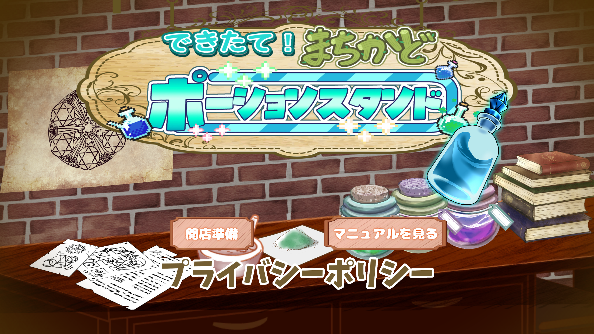
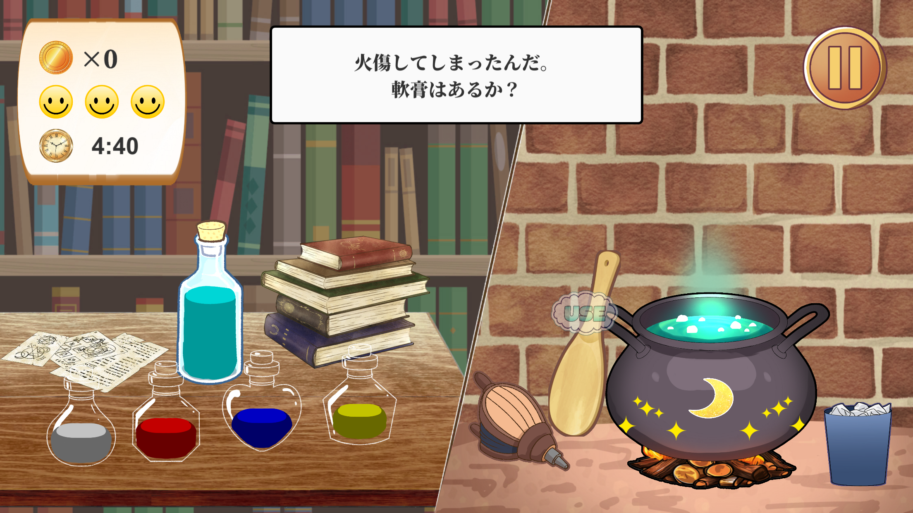
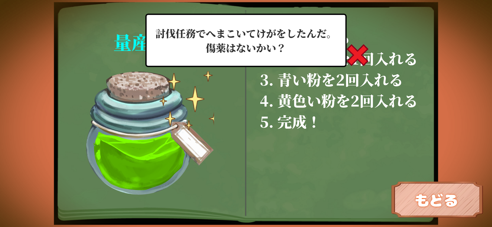

# できたて！ポーションスタンド

## 作品概要

プレイヤーがお客さんの注文に合わせてポーションを調合する、レシピ暗記・タイムアタックゲームです。

画面に表示されるレシピを覚え、材料や調理操作を正しい順番で入力してポーションを完成させます。難易度によってレシピの手順数や使用できる操作が変化し、制限時間や残機を意識しながらハイスコアを目指します。

## 制作情報

| 項目 | 内容 |
|---|---|
| ジャンル | レシピ暗記・タイムアタックゲーム |
| プラットフォーム | スマートフォン（iOS / Android） |
| 制作期間 | 4週間 |
| チーム人数 | 3人 |
| 担当 | 企画・C#プログラミング・ゲームシステムの実装 |
| チーム内分担 | イラスト制作、動作確認・Webサイトへの掲載 |
| 使用ソフト | Unity（C#） |

## ゲーム画面

### タイトル画面

### ゲームプレイ画面

### ゲーム画面・その他

## 主な実装機能

### レシピ生成システム
- 難易度に応じたレシピの手順数変更
- 材料や調理操作のランダム選択
- 材料の投入回数をランダムに決定
- 生成したレシピをレシピ本UIに表示

### 材料入力・正誤判定
- プレイヤーが入力した材料・操作を順番に記録
- 生成されたレシピと入力内容を照合
- 正解・不正解に応じた処理
- 入力内容のリセット機能

### 難易度・ゲーム進行管理
- Easy・Normal・Hardの3段階の難易度
- 難易度に応じた使用可能な操作の変更
- 制限時間と残機の管理
- ポーズ・ゲームオーバー・リザルト画面の制御

### スコア・記録管理
- 正解時のスコア加算
- 残機数に応じたボーナス計算
- 難易度別ハイスコアの保存
- 新記録達成時の演出

### UI・演出
- 長押し操作と円形ゲージの連動
- 注文コメントの文字送り表示
- ポーション名のランダム生成
- ビンの液体色のランダム変更
- 材料入力時のポップアップ演出

## 工夫した点

- 難易度ごとにレシピの手順数や使用できる調理操作を変え、段階的に難しくなる仕組みを実装した。
- 材料や調理操作をランダムに組み合わせることで、プレイするたびに異なるレシピになるようにした。
- プレイヤーの入力内容と生成されたレシピを照合し、正誤判定を行う仕組みを実装した。
- 長押し操作に円形ゲージを組み合わせ、操作の進行状況が視覚的に分かるようにした。
- スコアだけでなく残機数に応じたボーナスを加算し、最後までミスを抑えることがハイスコアにつながるようにした。

## 苦労した点

- 難易度ごとに異なる条件でレシピをランダム生成する処理。
- 材料の種類や投入回数、調理操作を考慮したレシピの管理。
- プレイヤーの入力順とレシピの内容を正確に照合する判定処理。
- スコア・残機・制限時間など、複数のゲーム進行要素の連携。

## 身についた技術

- ランダム生成・抽選処理
- リストやenumを利用したデータ管理
- 条件分岐による難易度制御
- プレイヤー入力の取得と判定
- 長押し操作・UIゲージ制御
- スコア・ハイスコアの保存
- ゲーム状態・画面遷移の管理

## ソースコード

C#スクリプトは以下のフォルダに掲載しています。

[ソースコード一覧（Scripts）](Scripts/)

主なスクリプト：

- `RecipeManager.cs`
- `GameManager.cs`
- `LongPressButton.cs`
- `ResultManager.cs`
- `UIManager.cs`

